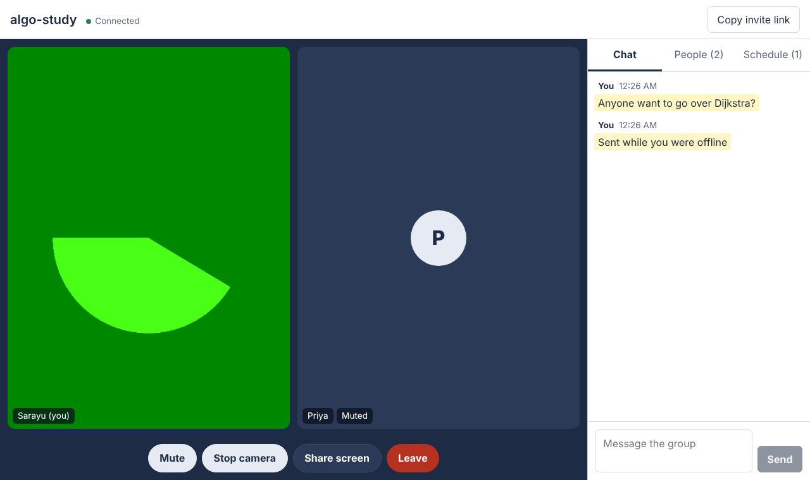
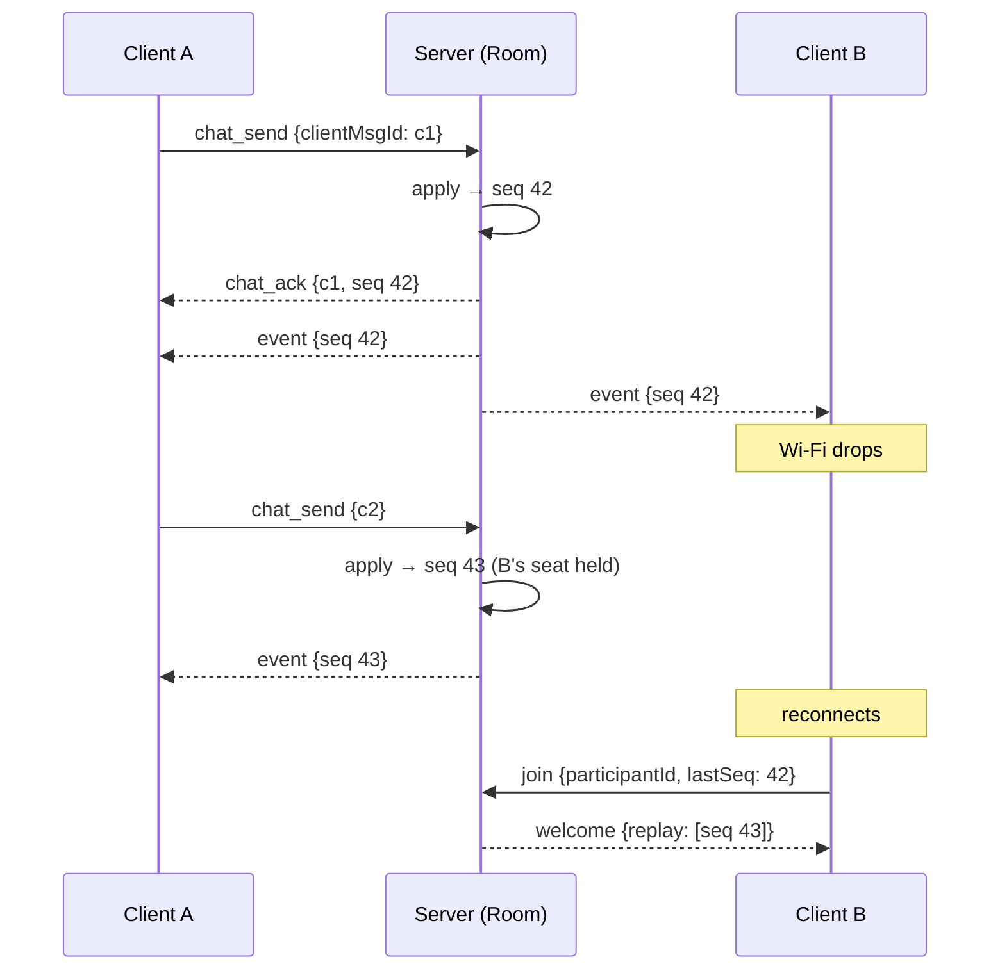

# StudentMeet

Real-time study rooms for small groups: video calls, live chat, screen sharing, and a shared session schedule, all synced over one WebSocket connection per client.



## What it does

- **Video and audio**: peer-to-peer WebRTC between everyone in the room, signaled over the room's WebSocket.
- **Screen sharing**: swaps the outgoing video track in place, so peers see the screen immediately with no renegotiation.
- **Live chat**: messages show up instantly for the sender and are confirmed by the server, never duplicated or reordered.
- **Scheduling**: anyone can plan a session; only the organizer can cancel it.
- **Survives bad networks**: drop Wi-Fi for a few seconds and you rejoin as the same person, catch up on what you missed, and anything you typed while offline gets sent.

## How the real-time layer works

The hard part of this project is keeping several clients' views of a room identical while connections drop and reconnect. The design comes down to one rule:

> **The server is the only thing that changes shared state, and every change gets a sequence number.**



**Sequenced events.** Clients send intents (`chat_send`, `media_update`, `session_schedule`). The server's `Room` applies each one, stamps it with the next `seq`, and broadcasts it. Every client applies events in `seq` order, so all clients see the same order of changes.

**Idempotent, gap-checked apply.** The client reducer ([`roomState.ts`](client/src/state/roomState.ts)) ignores any event with `seq <= current` (duplicate delivery) and refuses to apply one that skips ahead. A gap triggers a resync instead of silently drifting.

**Resume, not rejoin.** When a socket drops, the server holds the participant's seat for a 10-second grace window. A client reconnecting with its `participantId` and `lastSeq` gets back only the events it missed, replayed from a bounded log. Other participants never see a "left / joined" flicker. If the log no longer reaches back far enough, the server sends a full snapshot instead.

**Chat outbox with dedupe.** Each message gets a client-generated `clientMsgId`. Unconfirmed messages stay in an outbox and are resent after reconnecting. The server keys messages by author plus `clientMsgId`, so a resend returns the original instead of creating a duplicate.

**Heartbeats in both directions.** The server pings at the protocol level to detect half-open TCP connections (a laptop that went to sleep). The client sends app-level pings, because browsers don't expose WebSocket ping frames, and closes the socket if pongs stop. Reconnects use exponential backoff with jitter and retry immediately on the browser's `online` event.

**WebRTC with perfect negotiation.** [`PeerMesh.ts`](client/src/rtc/PeerMesh.ts) uses the [perfect negotiation](https://developer.mozilla.org/en-US/docs/Web/API/WebRTC_API/Perfect_negotiation) pattern, so either side can add a camera or start sharing at any time without coordinating who offers. Politeness comes from comparing participant ids, so both peers agree on who yields when offers collide.

## Project layout

```
shared/protocol.ts        Message types shared by client and server
server/src/room.ts        Room state: sequencing, event log, chat dedupe (no I/O)
server/src/hub.ts         Sockets ↔ seats, validation, grace-period resume, broadcast
server/src/validate.ts    Strict parsing of every incoming frame
server/src/index.ts       HTTP + WebSocket server, heartbeat
client/src/net/RoomClient.ts   WebSocket lifecycle, reconnect, outbox, external store
client/src/state/roomState.ts  Pure reducer for room state
client/src/rtc/PeerMesh.ts     WebRTC mesh with perfect negotiation
client/src/hooks/              useRoom (store binding), useCall (devices + mesh)
client/src/components/         Video tiles, chat, people, schedule panels
```

`Room` and `roomReducer` are pure, with no sockets or timers, so the ordering and dedupe rules are tested directly. Networking sits in thin layers around them.

## Running locally

Requires Node 20 or newer.

```bash
npm install
npm run dev
```

This starts the server on `:8787` and the client on [localhost:5173](http://localhost:5173). Open the room link in two browser windows to try it.

```bash
npm test          # server + client unit and integration tests
npm run typecheck
npm run build
```

The server tests in [`hub.test.ts`](server/src/hub.test.ts) run over real sockets. They cover resume within the grace window, eviction after it, duplicate-send dedupe, same-order delivery to all clients, socket replacement when the same user opens a second tab, room isolation for signaling, rate limiting, and permission checks.

## Limitations and next steps

- **Mesh topology.** Every participant sends video to every other participant, so upload bandwidth grows with room size. Rooms are capped at 8. Larger rooms would need an SFU such as mediasoup or LiveKit.
- **STUN only.** Calls between users behind strict NATs need a TURN server. Add one to `ICE_SERVERS` in `PeerMesh.ts` for production.
- **In-memory state.** Rooms live in one server process. Scaling out would need sticky sessions or a shared event log (Redis Streams, for example) so any node can replay events.
- **No auth.** Anyone with the room link can join.

## Tech

React 18, TypeScript, Vite, Node.js, `ws`, WebRTC, Vitest.
